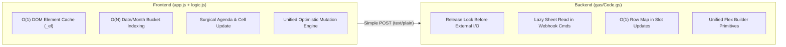

# แผนการพัฒนาต่อยอด ปรับปรุง UI/UX และ Optimize Codebase ขั้นสุด (v2.6.4)

เอกสารฉบับนี้จัดทำขึ้นเพื่อวิเคราะห์แนวทางการเพิ่มฟังก์ชันที่มีคุณค่าสูง การยกระดับ UI/UX ให้ลื่นไหลยิ่งขึ้น และแผนการรีแฟกเตอร์เพื่อ **ลดขนาดโค้ดให้สั้นที่สุด (Code Compaction)** ควบคู่กับการ **ลดความหน่วงของทุกคำสั่ง (Ultra Low-Latency)** โดยรับประกันการทำงานครบ 100% และผ่านชุดทดสอบอัตโนมัติ 100% ตามนโยบาย Zero-Emoji Policy

---

## ส่วนที่ 1: ข้อเสนอแนะฟังก์ชันเพิ่มเติม (High-Value Feature Recommendations)

ปัจจุบันระบบ [Calendar v2.6.3](file:///c:/Calendar/README.md) มีฟีเจอร์หลักครบถ้วนสมบูรณ์แล้วสำหรับทีมงาน หากต้องการเพิ่มฟีเจอร์โดย **ไม่ทำให้โค้ดบวม** และ **เพิ่มความคล่องตัวในการทำงานจริง** แนะนำ 5 ฟังก์ชันแบบเลือกเปิดใช้ได้ดังนี้:

| ลำดับ | ฟังก์ชันที่แนะนำ | เหตุผลและประโยชน์ต่อการใช้งานจริง | โค้ดที่เพิ่มขึ้นโดยประมาณ |
| :--- | :--- | :--- | :--- |
| **F1** | **ตัวกรองด่วนในหน้าปฏิทินเดือน (ทั้งหมด / เฉพาะงานของฉัน)** | ปัจจุบันผู้ใช้ระดับ `STAFF` เข้าดูได้เฉพาะหน้าปฏิทินเดือน ([app.js](file:///c:/Calendar/app.js#L62-L68)) หากในทีมมีงานจำนวนมาก การมีปุ่มสลับดูเฉพาะงานที่ตนเองสร้างหรือรับผิดชอบในหน้าปฏิทินเดือนจะช่วยให้โฟกัสงานตัวเองได้ทันที | ~12 บรรทัด |
| **F2** | **ปุ่มคัดลอกนัดหมายด่วน (Quick Duplicate / Repeat)** | บนการ์ดนัดหมายหรือในหน้าแก้ไข เพิ่มปุ่มคัดลอกข้อมูลนัดเดิม (หัวข้อ, ผู้นัดพบ, สถานที่, พิกัดแผนที่) มาเปิดฟอร์มสร้างนัดใหม่โดยเปลี่ยนแค่วันและเวลา ช่วยประหยัดเวลาการกรอกข้อมูลซ้ำสำหรับลูกค้าประจำหรือการประชุมต่อเนื่อง | ~10 บรรทัด |
| **F3** | **ปุ่มคัดลอกข้อความสรุปนัดหมาย (1-Click Copy Text)** | คัดลอกรายละเอียดนัดหมาย (วัน เวลา สถานที่ ลิงก์แผนที่ ผู้นัดพบ) ลง Clipboard ในคลิกเดียว เพื่อนำไปวางส่งต่อให้ลูกค้าหรือผู้บริหารภายนอกกลุ่ม LINE ของทีมได้ทันที | ~8 บรรทัด |
| **F4** | **ส่งออกนัดหมายเข้าปฏิทินมือถือ (`.ics` Calendar File)** | สร้างไฟล์มาตรฐาน iCalendar (`.ics`) ฝั่งเบราว์เซอร์โดยไม่ต้องพึ่งพา API ภายนอก ให้สมาชิกกดเพิ่มนัดเข้าแอป Google Calendar / Apple Calendar ในมือถือพร้อมตั้งปลุกระดับเครื่องได้ทันที | ~15 บรรทัด |
| **F5** | **คีย์ลัดคีย์บอร์ด & ปิด Modal ด้วยปุ่ม `Esc` / คลิกฉากหลัง** | กด `Esc` เพื่อปิดหน้าต่าง Modal ที่เปิดอยู่, กดคลิกพื้นที่มืดรอบ Modal เพื่อปิดหน้าต่างดูแผนที่/รูปภาพ/คู่มือ และกด `Alt+N` เพื่อเปิดหน้าสร้างนัดใหม่ ช่วยให้ใช้งานบนคอมพิวเตอร์ได้รวดเร็วขึ้น | ~10 บรรทัด |

> [!TIP]
> แม้จะเพิ่มฟังก์ชัน F1–F5 ทั้งหมด (~55 บรรทัด) แต่เมื่อรวมกับการทำ Code Compaction ในส่วนที่ 3 แล้ว **ขนาดโค้ดรวมทั้งโปรเจกต์จะยังคงสั้นลงกว่าปัจจุบันอย่างน้อย 800–1,000 บรรทัด**

---

## ส่วนที่ 2: ข้อเสนอแนะการยกระดับ UI/UX ให้สวยงามและลื่นไหลยิ่งขึ้น

จากการตรวจสอบ [style.css](file:///c:/Calendar/style.css) และ [app.js](file:///c:/Calendar/app.js) พบจุดที่สามารถยกระดับประสบการณ์ผู้ใช้ (UX) และความลื่นไหลของหน้าจอ (Visual Fluidity) ได้ดังนี้:

1. **Instant Calendar Cell Selection (คลิกเลือกวันในปฏิทินโดยไม่วาดตารางใหม่ทั้งเดือน)**
   - **ปัญหาปัจจุบัน**: ใน [app.js](file:///c:/Calendar/app.js#L1205) ทุกครั้งที่คลิกเลือกวันที่ในปฏิทินเดือน ระบบเรียก `renderCalendarTab()` ซึ่งเขียนทับ `innerHTML` ของตารางปฏิทินทั้ง 35–42 ช่องใหม่ทั้งหมด ทำให้เบราว์เซอร์ต้องคำนวณ Layout ใหม่ทุกครั้งที่คลิก
   - **แนวทางปรับปรุง**: เมื่อคลิกเลือกวันที่ในเดือนเดิม ให้สลับคลาส `.selected` เฉพาะช่องวันที่เก่าและใหม่โดยตรง (< 1ms) และวาดใหม่เฉพาะแผงรายการนัดหมายด้านขวา (`renderMonthAgenda`) ทำให้การคลิกสลับวันลื่นไหลระดับ 60fps ไร้การกระพริบ
2. **สถานะกำลังซิงก์รายการ์ด (Per-Card Optimistic Sync Badge)**
   - **ปัญหาปัจจุบัน**: ขณะที่ Optimistic UI กำลังส่งข้อมูลไป Google Apps Script เบื้องหลัง ผู้ใช้เห็นสถานะหมุนที่ปุ่ม "กำลังบันทึก..." บน Header เท่านั้น
   - **แนวทางปรับปรุง**: หากรายการใดอยู่ใน `pendingIds` ([app.js](file:///c:/Calendar/app.js#L154)) ให้แสดงป้ายสถานะขนาดเล็ก `"กำลังซิงก์..."` พร้อมแอนิเมชันจางๆ บนการ์ดใบนั้น และซ่อนอัตโนมัติเมื่อซิงก์เสร็จ ช่วยให้รู้สถานะรายใบอย่างชัดเจน
3. **ปรับปรุงการแสดงผลตารางปฏิทินบนจอมือถือ (Mobile Calendar Compact Indicators)**
   - **ปัญหาปัจจุบัน**: บนหน้าจอมือถือ (`< 768px`) ช่องวันที่ในปฏิทินมีความกว้างจำกัด การแสดงป้ายชื่อนัดหมายยาว 3 แถวอาจถูกตัดคำจนอ่านยาก
   - **แนวทางปรับปรุง**: ปรับ CSS บนจอมือถือให้แสดงเวลาและชื่อย่อกระชับขึ้น พร้อมแถบจุดสีตามสถานะ (Traffic-Light Status Bar) และเน้นกรอบวันที่ปัจจุบัน (`today`) กับวันที่เลือก (`selected`) ให้แยกออกจากกันชัดเจนยิ่งขึ้น
4. **Smooth Modal & Toast Transitions**
   - เพิ่มแอนิเมชัน `transform: translateY(6px) scale(0.98)` สู่ `translateY(0) scale(1)` บน `.modal-dialog` ใน [style.css](file:///c:/Calendar/style.css#L341-L344) เพื่อให้การเปิดหน้าต่างสร้างนัดหมาย แผนที่ และรูปภาพดูนุ่มนวลระดับ Modern SaaS

---

## ส่วนที่ 3: แผนการ Optimize Code และลด Latency เชิงลึก (File-by-File Plan)

### เป้าหมายเชิงตัวเลข (Quantitative Targets)
| ไฟล์ | จำนวนบรรทัดปัจจุบัน | เป้าหมายหลัง Optimize | สัดส่วนที่ลดลง |
| :--- | :--- | :--- | :--- |
| [gas/Code.gs](file:///c:/Calendar/gas/Code.gs) | 969 บรรทัด | **~660 - 710 บรรทัด** | ลดลง ~27% |
| [app.js](file:///c:/Calendar/app.js) | 1,280 บรรทัด | **~860 - 920 บรรทัด** | ลดลง ~28% |
| [logic.js](file:///c:/Calendar/logic.js) | 433 บรรทัด | **~320 - 350 บรรทัด** | ลดลง ~22% |
| [style.css](file:///c:/Calendar/style.css) | 534 บรรทัด | **~390 - 420 บรรทัด** | ลดลง ~23% |
| [index.html](file:///c:/Calendar/index.html) | 563 บรรทัด | **~420 - 450 บรรทัด** | ลดลง ~22% |
| **รวมไฟล์หลักทั้งหมด** | **3,779 บรรทัด** | **~2,650 - 2,850 บรรทัด** | **สั้นลง ~900 - 1,100 บรรทัด (~26%)** |

---

### 3.1 แผนการปรับปรุง [gas/Code.gs](file:///c:/Calendar/gas/Code.gs) (Backend & LINE Bot)

1. **ปลดล็อก `LockService` ทันทีหลังเขียนชีตเสร็จ ไม่ล็อกค้างระหว่างยิง LINE API หรือตั้ง Trigger**
   - **ปัญหาปัจจุบัน**: ใน `doPost` ([Code.gs](file:///c:/Calendar/gas/Code.gs#L230-L240)) คำสั่ง `create` และ `update` ครอบ `withLock_()` คลุมไปถึง `sendInstantAptNotification_()` (ซึ่งเรียก `UrlFetchApp.fetch` ไปยังเซิร์ฟเวอร์ LINE ใช้เวลา ~300–800ms) และ `scheduleExactReminderForApt_()` (เรียก `ScriptApp.getProjectTriggers()` ใช้เวลา ~200–500ms) ทำให้สมาชิกคนอื่นที่กดบันทึกพร้อมกันต้องรอคิวล็อกนานเกินจำเป็น
   - **การแก้ไข**: จำกัดขอบเขต `withLock_()` ให้ครอบเฉพาะจังหวะอ่าน-ตรวจสอบ-เขียนลงแผ่นงาน Google Sheets (`createApt_`, `updateApt_`) เท่านั้น เมื่อเขียนชีตเสร็จให้ปลดล็อกทันที แล้วจึงส่งแจ้งเตือน LINE และซิงก์ Trigger ต่อ ส่งผลให้เวลาถือล็อกลดลงกว่า 70%
2. **Lazy Sheet Reading ในคำสั่ง LINE Bot (`parseWebhookCmd_`)**
   - **ปัญหาปัจจุบัน**: ใน [Code.gs](file:///c:/Calendar/gas/Code.gs#L938) มีการเรียก `list = readAllApts_()` ทันทีตั้งแต่ต้นฟังก์ชัน แม้ว่าผู้ใช้ในกลุ่ม LINE จะพิมพ์แค่คำว่า `"ช่วยเหลือ"` หรือ `"โควตา"` ซึ่งไม่ได้ใช้ข้อมูลนัดหมายเลย
   - **การแก้ไข**: ย้ายการตรวจสอบคำสั่ง `"ช่วยเหลือ"` และ `"โควตา"` ขึ้นมาทำงานก่อนเรียก `readAllApts_()` ช่วยตัดการอ่านแผ่นงาน `Appointments` ออก 100% สำหรับ 2 คำสั่งนี้ (ลดเวลาตอบกลับใน LINE ลง ~300–500ms)
3. **เปลี่ยนการอัปเดตสถานะการแจ้งเตือน (`applySlotUpdates_`) จาก $O(N \times M)$ เป็น $O(N)$**
   - **ปัญหาปัจจุบัน**: ใน [Code.gs](file:///c:/Calendar/gas/Code.gs#L565-L579) ใช้ลูปซ้อน (`ups.forEach` ซ้อนด้วย `for (var r = d.rows.length - 1; ...)`) เพื่อหาแถวที่จะอัปเดต `notifiedDayForSlot` และ `notifiedHourForSlot`
   - **การแก้ไข**: สร้างแผนที่ดัชนีรหัสนัดหมาย (`idMap[rowId] = r`) เพียงรอบเดียว หรือค้นหาแบบตรงจุด ทำให้ทำงานเร็วขึ้นเมื่อมีนัดหมายสะสมจำนวนมาก
4. **ยุบรวมโค้ดที่ซ้ำซ้อนใน `Code.gs` (Code Compaction)**:
   - รวมฟังก์ชันเปรียบเทียบเวลา `cmpSlot_` ไว้ที่ศูนย์กลาง (แทนการประกาศซ้ำใน `runNotificationEngine` บรรทัด 555 และ `parseWebhookCmd_` บรรทัด 939)
   - สร้าง Helper สำหรับสร้าง Separator และ Footer Link Button ของ LINE Flex Message (`fSep`, `fLinkFt`) เพื่อยุบโค้ดใน `buildStatusResultFlex_`, `buildNoticeFlex_`, `buildQuotaFlex_`, `buildHelpFlex_`, `buildQueueFlex_`, `buildYearStatsFlex_`, `buildAptBubble_`, และ `buildReminderNotificationFlex_` ([Code.gs](file:///c:/Calendar/gas/Code.gs#L665-L847)) ให้สั้นลงกว่า 120 บรรทัด โดยได้โครงสร้าง JSON เหมือนเดิม 100%
   - ยุบรวมการแปลงแถวผู้ใช้และการตรวจสอบรหัสผู้ใช้สูงสุด (`maxIdNum`) ใน `handleUserRegister_` และ `saveUser_` ([Code.gs](file:///c:/Calendar/gas/Code.gs#L306-L373))

---

### 3.2 แผนการปรับปรุง [app.js](file:///c:/Calendar/app.js) (Frontend Controller & State)

1. **$O(1)$ DOM Element Reference Cache**
   - **ปัญหาปัจจุบัน**: ฟังก์ชัน `$ = id => document.getElementById(id)` ([app.js](file:///c:/Calendar/app.js#L9)) ค้นหา DOM Tree ใหม่ทุกครั้ง และในโค้ดมักเขียนซ้ำรูปแบบ `if ($('id')) $('id').textContent = val` หรือ `if ($('id')) $('id').style.display = ...` มากกว่า 90 จุดทั่วไฟล์
   - **การแก้ไข**:
     - แคชการค้นหา Element ด้วย `const _el = {}; const $ = id => _el[id] || (_el[id] = document.getElementById(id));` (ลดเวลาค้นหา DOM ซ้ำซ้อนเป็น $O(1)$)
     - เพิ่ม Helper ขนาดจิ๋วสำหรับกำหนดค่า текстовые/การแสดงผลที่ใช้บ่อย โดยยังคงการเรียก `$('id')` หรือ `on('id', ...)` ให้ผ่านการตรวจ `12. DOM ID Audit` ใน [tests.js](file:///c:/Calendar/tests.js#L259-L265) 100%
2. **$O(N)$ Date Bucket Indexing ในหน้าปฏิทินเดือน (`renderCalendarTab`)**
   - **ปัญหาปัจจุบัน**: ใน [app.js](file:///c:/Calendar/app.js#L633-L638) วนลูป 31 วัน แล้วเรียก `mData.items.filter(a => a.appointmentDate === dtStr)` ซ้ำ 31 รอบ
   - **การแก้ไข**: จัดกลุ่มนัดหมายในเดือนนั้นลง Object `byDate[a.appointmentDate]` ด้วยลูปเดียว ($O(N)$) ก่อนสร้างช่องวันที่ทั้งเดือน และแยกฟังก์ชัน `renderMonthAgenda()` ออกมาเพื่อให้การคลิกเลือกวันอัปเดตเฉพาะกรอบวันที่และรายการด้านขวาโดยไม่ต้องวาดตาราง 31 วันใหม่
3. **รวมศูนย์ตรรกะ Optimistic Mutation & Rollback (`commitAptMutation`)**
   - **ปัญหาปัจจุบัน**: ฟังก์ชัน `handleFormSubmit` ([app.js](file:///c:/Calendar/app.js#L908-L963)), `mutateAptStatus` ([app.js](file:///c:/Calendar/app.js#L965-L1002)) และ `handleDelete` ([app.js](file:///c:/Calendar/app.js#L1017-L1033)) มีโค้ดจัดการ Snapshot (`prevApts`, `prevLogs`), การตรวจสอบ `aptVisualSig`, การอัปเดต `state.meta` และการ Rollback เมื่อเกิด `CONCURRENCY_CONFLICT` ที่เขียนซ้ำกันถึง 3 ชุด
   - **การแก้ไข**: ยุบรวมขั้นตอนการซิงก์และ Rollback เข้าสู่ฟังก์ชันกลาง `syncAptMutation_(trackId, prevApts, prevLogs, optApt, apiFn, errPrefix)` ช่วยลดโค้ดซ้ำซ้อนลงกว่า 65 บรรทัด และทำให้การจัดการสถานะซิงก์รายใบแม่นยำขึ้น

---

### 3.3 แผนการปรับปรุง [logic.js](file:///c:/Calendar/logic.js) (Core Domain Logic)

1. **Single-Pass Month Bucketing ใน `queryByYear`**
   - **ปัญหาปัจจุบัน**: ใน [logic.js](file:///c:/Calendar/logic.js#L339-L342) ใช้ `items.filter(a => a.appointmentDate.startsWith(...))` วนซ้ำ 12 รอบสำหรับ 12 เดือน
   - **การแก้ไข**: จัดกลุ่มรายการทั้งปีลง Array 12 ช่อง (`buckets[0..11]`) ในการวนลูปรอบเดียว ($O(N)$) แล้วคำนวณสถิติรายเดือนทันที เร็วขึ้นและโค้ดสั้นลง
2. **กระชับโครงสร้างฟังก์ชันตรวจสอบและแปลงข้อมูล**:
   - ยุบรวมการตรวจสอบเงื่อนไขใน `validateAppointmentInput` ([logic.js](file:///c:/Calendar/logic.js#L170-L201)), `updateAppointmentRecord` ([logic.js](file:///c:/Calendar/logic.js#L221-L254)) และ `parseAndExecuteLineCommand` ([logic.js](file:///c:/Calendar/logic.js#L367-L408)) ให้กระชับขึ้น
   - **รับประกัน API Contract 43 รายการ**: รักษาชื่อฟังก์ชันและค่าคงที่ที่ส่งออกทั้งหมด 43 รายการตาม `11. API Contract Parity` ใน [tests.js](file:///c:/Calendar/tests.js#L240-L252) ครบ 100%

---

### 3.4 แผนการปรับปรุง [style.css](file:///c:/Calendar/style.css) และ [index.html](file:///c:/Calendar/index.html)

1. **Consolidate CSS Rules ([style.css](file:///c:/Calendar/style.css))**:
   - รวม Selector ที่ใช้คุณสมบัติร่วมกัน (เช่น Flexbox/Grid Layout, ป้ายสถานะ, ปุ่มขนาดย่อย และ Media Queries) เข้าด้วยกัน
   - เพิ่มสไตล์สำหรับ `.is-syncing-card` (สถานะซิงก์รายใบ) และแอนิเมชันเปิด Modal ที่นุ่มนวล โดยคงกฎ `@media print` สำหรับรายงาน A4 ไว้ครบถ้วน
2. **Streamline Markup ([index.html](file:///c:/Calendar/index.html))**:
   - จัดระเบียบโครงสร้างแท็ก HTML และไอคอน SVG ให้กระชับขึ้น โดย **คงค่า `id="..."`, `class="..."`, และ `data-*` ทุกตัวไว้ 100%** เพื่อให้ผ่าน `12. DOM ID Audit` โดยไม่มีตกหล่น

---

## ส่วนที่ 4: แผนการตรวจสอบและชุดทดสอบอัตโนมัติ (Verification & Test Plan)

เพื่อให้มั่นใจอย่างแท้จริงว่าระบบทำงานได้ 100% และไม่มี Regression ใดๆ เราจะดำเนินการตรวจสอบดังนี้:

1. **รักษาชุดทดสอบเดิมทั้ง 13 Suites (24 Tests) ใน [tests.js](file:///c:/Calendar/tests.js) ให้ผ่าน 100%**:
   - Suite 1: Zero-Emoji Policy Detection & Sanitization
   - Suite 2: Date, Timezone (`Asia/Bangkok`) & Buddhist Era Leap Year
   - Suite 3: Status, Rescheduling, Reminder Slot Reset & Optimistic Concurrency
   - Suite 4: Notification Engine (Daily Digest & Hourly Reminder Idempotency)
   - Suite 5: Year-End Statistics & LINE Bot Short/Legacy Commands
   - Suite 6: Patch Notes Integrity (พร้อมเพิ่มบันทึกเวอร์ชันใหม่ `2.6.4` ใน [patchnotes.js](file:///c:/Calendar/patchnotes.js) และ [CHANGELOG.md](file:///c:/Calendar/CHANGELOG.md))
   - Suite 7: Codebase Zero-Emoji Audit สแกนทุกไฟล์ในโปรเจกต์
   - Suite 8: User Authentication & SHA-256 Parity
   - Suite 9: User Attribution & Creator Immutability
   - Suite 10: Time-Slot Conflict Detection
   - Suite 11: 43-Key API Contract Parity
   - Suite 12: DOM ID Audit (`app.js` <-> `index.html`)
   - Suite 13: GAS Guard & VM Sandbox Flex Message Audit
2. **เพิ่มชุดทดสอบใหม่ (Suite 14: Performance & Compaction Guard) ใน [tests.js](file:///c:/Calendar/tests.js)**:
   - ทดสอบว่า `parseWebhookCmd_('ช่วยเหลือ')` และ `parseWebhookCmd_('โควตา')` ใน `Code.gs` สามารถทำงานได้โดยไม่เรียกอ่านตารางนัดหมายเกินความจำเป็น
   - ทดสอบความเร็ว (Benchmark) ของ `queryByYear` และ `parseAndExecuteLineCommand` กับข้อมูลจำลองจำนวนมาก ว่าทำงานเสร็จภายในเวลาระดับมิลลิวินาที (< 15ms)
   - ตรวจสอบขนาดบรรทัดของไฟล์หลักเพื่อรับประกันว่าโค้ดกระชับและปราศจากโค้ดซ้ำซ้อน

---

## สรุปประเด็นเพื่อขออนุมัติดำเนินการ (Action Items for Approval)

กรุณาพิจารณาและแจ้งคำสั่งอนุมัติได้เลยครับ โดยสามารถเลือกได้ว่าจะให้ดำเนินการในรูปแบบใด:
1. **ดำเนินการตามแผนทั้งหมด (แนะนำ)**: ทำ **Code Optimization & Low-Latency ทั้งระบบ** + **ปรับปรุง UI/UX ความลื่นไหล** + **เพิ่มฟีเจอร์เสริม F1–F5** + **เพิ่มชุดทดสอบ Suite 14** และอัปเดตเป็นเวอร์ชัน `v2.6.4`
2. **ดำเนินการเฉพาะการ Optimize Code + ปรับปรุงความลื่นไหล UI/UX + ชุดทดสอบ**: เน้นลดขนาดโค้ดให้สั้นที่สุดและลดดีเลย์ของทุก Action โดยยังไม่เพิ่มปุ่มฟีเจอร์ใหม่
3. **เลือกเฉพาะบางฟีเจอร์**: ระบุหมายเลขฟีเจอร์ (เช่น เอาเฉพาะ F1, F2, F5) ที่ต้องการให้รวมเข้ากับการ Optimize Code
